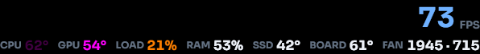
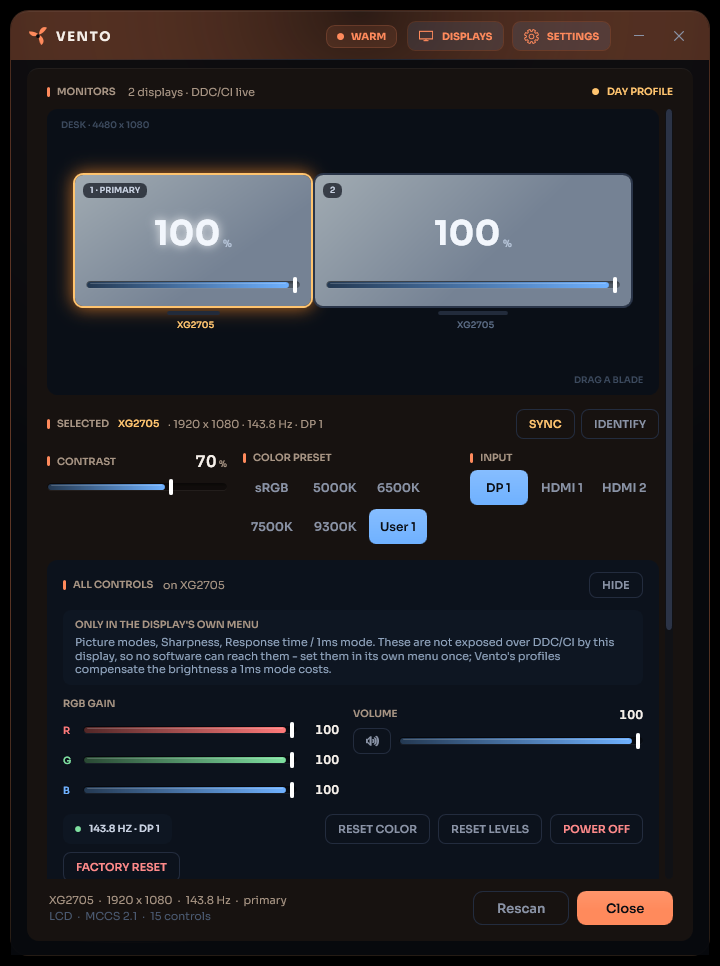

<div align="center">


# Vento

**Fan control, an in-game overlay, and display control for Windows**

[](https://github.com/Henkerr/vento)
[](https://learn.microsoft.com/powershell/)
[](LICENSE)

### [⬇ Download Vento](https://github.com/Henkerr/vento/releases/latest)

<sub>Windows 10/11 · needs administrator rights for the fan sensors · updates itself from then on</sub>

</div>

A lightweight system-tray app that started as a fan controller and grew into a small
desktop companion: it drives your motherboard's fans, paints an in-game overlay with
real per-game FPS, and controls every display over DDC/CI — all from one place, and all
offline. No account, no telemetry, nothing written outside its own folder.

Vento reads CPU, GPU, SSD and motherboard temperatures plus fan speeds through
[LibreHardwareMonitor](https://github.com/LibreHardwareMonitor/LibreHardwareMonitor) and
measures frame rate the way PresentMon does — a live ETW trace of the display present
stream — so FPS works on any GPU without a vendor SDK.

<p align="center"></p>

## Fan control

- **Live dashboard** — CPU, GPU, SSD (hottest drive) and motherboard temperatures with
  color-coded bars and 10-minute history sparklines, plus CPU / case / GPU fan RPM.
- **Five modes** — Quiet, Normal, Performance, Curve (a fan curve over 40/55/70/80 °C
  points), Auto (BIOS curve). Switchable from the window or the tray; the last mode is
  restored at launch, and re-applied automatically after the PC wakes from sleep.
- **Cooling boost (Quiet mode)** — when CPU or GPU passes a threshold (default 75 °C) the
  case fans ramp up, then drop back to Quiet once temps fall below the resume threshold
  (default 65 °C). Hysteresis prevents oscillation.
- **Game action** — sustained GPU load (default >80 % for 30 s) can switch to Performance
  or follow the Curve automatically, then return to your previous mode a couple of minutes
  after the game ends, with a configurable post-game cooldown. Or set it to do nothing.
- **Mode panel** — the active mode's settings sit right under the selector (fan
  percentages, boost temperatures, or curve points). Slider changes apply to the fans
  instantly; a Reset restores that mode's defaults. A live graph tracks CPU and case fan
  RPM over the last 10 minutes.
- **Safety guard** — in any manual mode, if CPU/GPU exceeds a hard limit (default 85/83 °C)
  Vento forces Auto and warns you.

## In-game overlay

<p align="center"></p>

- **A click-through, always-on-top readout** with seven layouts (Blade, Strip, Hero, Pills,
  Ghost, Micro, Thermo Edge) and six themes that walk their own cool/warm/hot accents with
  the thermal state, plus per-metric custom colors.
- **Metrics** — real per-game **FPS**, CPU/GPU/SSD/board temperatures, GPU load, RAM usage
  (and temperature on modules that report one), fan speeds. Toggle any of them.
- **FPS the way PresentMon does it** — a live ETW trace of the present stream, counted per
  process, so it works on any GPU with no bundled tools; it follows the focused game (or
  the busiest thing presenting behind a borderless overlay) and never counts Vento itself.
- **Placed your way** — pick a corner and scale (75–200 %), or drop the mouse on the HUD
  for a pin and drag it anywhere; the scroll wheel sets its opacity. Show it always, only
  while gaming, or never. Every choice is remembered. Works over borderless and windowed
  games; true exclusive fullscreen hides any overlay.

## Display control (DDC/CI)

<p align="center"></p>

- **A MONITORS panel** that drives every connected display over the same channel its own
  buttons use — brightness, contrast, color presets, input source, RGB gain, sharpness,
  speaker volume, picture mode, soft power. Values are read fresh from each monitor, and
  only the controls a display actually honors are shown.
- **Your desk, drawn to scale** — the displays appear as they sit on the desktop, each
  carrying its own brightness; click one to point the controls at it, IDENTIFY to match
  them up.
- **Display profiles** — DAY / NIGHT / CINEMA / GAME (and your own) apply a
  brightness/contrast/color recipe in one tap, to every display or just the selected one,
  each with an identity color. Right-click to edit or delete; the built-in values are
  calibration-backed, not invented.
- **Night shift** — a schedule that dims the displays to a chosen profile inside a nightly
  window and restores what was active on the way out.
- **Safe by design** — Vento only ever writes codes a display advertises, never the
  manufacturer-private range; an input switch reverts itself unless kept; factory reset
  asks first.

## Elsewhere

- **Real Windows notifications** — a new version or a heat warning arrives as a toast that
  waits in the notification center, and the update toast has an **Install now** button.
- **Auto-update** — checks GitHub Releases at launch; one click downloads the new installer
  and updates silently.
- **Start with Windows without UAC prompts** — a highest-privilege scheduled task, offered
  in the installer and in Settings.
- **System tray** — close/minimize hides to tray; the tooltip shows live temps; the
  right-click menu switches modes, moves the overlay, and installs updates.
- **Portable and private** — a folder, a script, and the sensor DLLs. Nothing is written
  outside the app folder except the optional startup task and update downloads in `%TEMP%`.

## Requirements

- Windows 10/11, PowerShell 5.1 (built in)
- Administrator rights — required for SuperIO fan sensors, DDC/CI, and the FPS trace
- .NET Framework 4.7.2+ (built into Windows 10/11)

Fan **control** depends on the board exposing its fan channels to LibreHardwareMonitor;
most consumer desktop boards do, most laptops and locked-down OEM machines do not — there
Vento still monitors, and FPS and display control still work. FPS needs an NVIDIA/AMD/Intel
GPU that presents through DXGI/D3D9 (i.e. any of them); display control needs a monitor
that speaks DDC/CI (most desktop monitors, not laptop internal panels).

## Getting started

**Installer (recommended):** download
[`VentoSetup.exe`](https://github.com/Henkerr/vento/releases/latest) and run it. You get
Start Menu / desktop shortcuts, a run-at-startup task (changeable in Settings), and a clean
uninstaller.

**From source:** clone the repository and double-click `Vento.vbs` (or build `Vento.exe`,
see below), then accept the admin prompt.

## Building

No SDK needed — everything uses tools already on Windows (plus Inno Setup for the installer):

```powershell
build\build-exe.ps1     # compiles Vento.exe (launcher with icon + UAC manifest)
ISCC.exe installer\vento.iss   # builds dist\VentoSetup.exe (Inno Setup 6)
```

Tagging a release (`git tag v1.6.1 && git push --tags`) builds the installer and publishes
it via GitHub Actions. Release history is in [CHANGELOG.md](CHANGELOG.md).

## Configuration

Everything editable in the UI is stored in `settings.json` (created on first save). Three
extra keys are file-only, for remapping which SuperIO channels drive which fans on your
board and which temperature sensor feeds the BOARD card:

```json
{
  "cpuFanChannel": "Fan #1",
  "caseFanChannel": "Fan #2",
  "mbTempSensor": "auto"
}
```

If a named channel doesn't exist, Vento falls back to the first/second fan channel it
finds. All remaining channels are left on the BIOS default curve. `mbTempSensor` set to
`"auto"` picks a plausible SuperIO temperature sensor by name; set it to an exact sensor
name (e.g. `"Temperature #3"`) to override.

## Safety notes

- The case fan hub is never driven below 20 %, the CPU fan never below 30 %.
- On exit (including crashes) all fan channels are handed back to the BIOS, and after the
  PC wakes from sleep the active mode is re-applied so the fans don't stay on a BIOS curve.
- Display writes are limited to codes a monitor advertises; the manufacturer-private VCP
  range is never written.
- Vento refuses to run alongside FanControl — two programs writing to the same SuperIO
  registers is a bad idea.

## How it works

One script, a few threads: an MTA runspace owns LibreHardwareMonitor exclusively (polling
sensors and applying modes), a dedicated runspace serializes DDC/CI monitor traffic, a
real-time ETW consumer counts frame presents, and the STA thread runs the WPF window,
overlay and tray icon. They communicate through a synchronized hashtable — the UI never
touches the hardware directly.

## License

Vento is MIT-licensed — see [LICENSE](LICENSE).
Bundled third-party libraries in `lib/` (LibreHardwareMonitorLib and dependencies) have
their own licenses — see [THIRD-PARTY-NOTICES.md](THIRD-PARTY-NOTICES.md).
